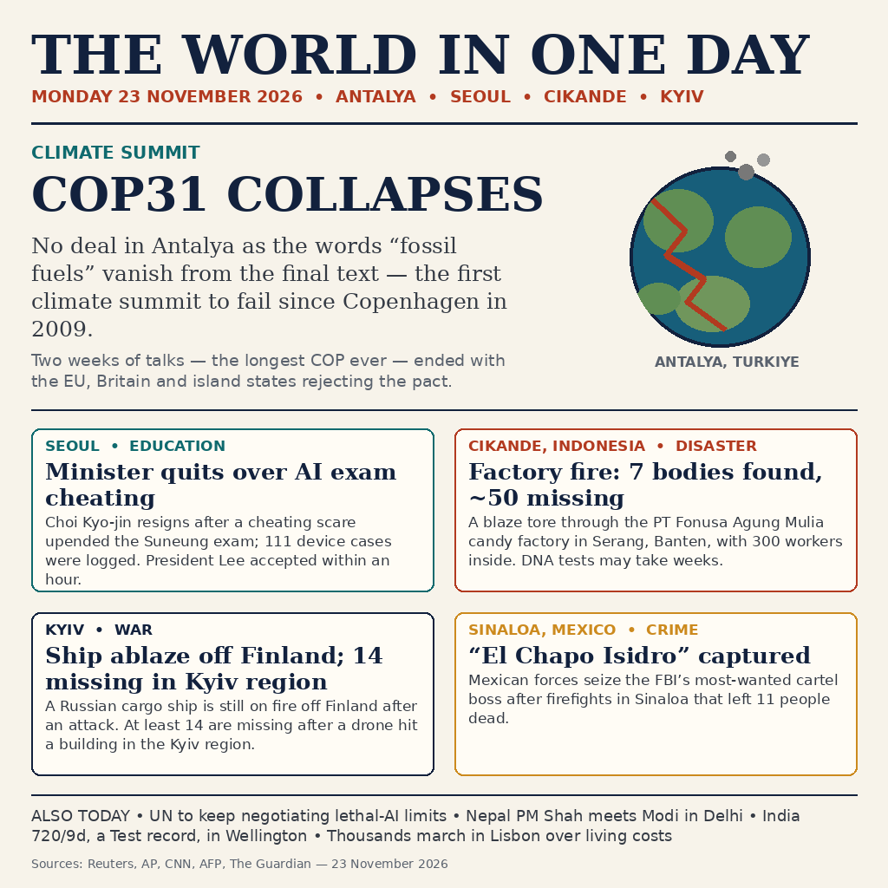

# The World in One Day — Monday 23 November 2026

A single front-page poster that sums up Monday 23 November 2026's world news in one image — an entry for the [make.fun bounty "Sum up 23 November's world news in one image"](https://make.fun/bounty/news-image-20261123).

## What's on the poster

**Top story — COP31 collapses.** After two weeks of talks in Antalya, Turkiye — the longest COP ever — the EU, Britain and island states rejected the final "Antalya Pact" because it made no mention of fossil fuels. It is the first climate summit to fail outright since Copenhagen in 2009. Sources: CNN, AP, Le Monde, The Times (23 November 2026).

**Four more stories:**

- **Seoul** — Education Minister Choi Kyo-jin resigns after an AI-assisted cheating scare upended the Suneung university entrance exam; 111 cases of device misconduct were logged, and President Lee Jae Myung accepted the resignation within an hour.
- **Cikande, Indonesia** — A fire tore through the PT Fonusa Agung Mulia candy factory in Serang, Banten, with 300 workers inside; seven body bags were recovered and about 50 workers were missing, with DNA identification expected to take weeks.
- **Kyiv / Baltic** — A Russian cargo ship is still on fire off Finland after an attack, and at least 14 people are missing after a Russian drone hit a building in the Kyiv region.
- **Sinaloa, Mexico** — Mexican forces capture "El Chapo Isidro", the FBI's most-wanted cartel boss, after firefights that left 11 people dead.

**Also today (footer ticker):** UN states agree to keep negotiating limits on lethal AI weapons; Nepal's PM Balendra Shah meets Modi in Delhi; India posts a record 720/9d in the Wellington Test; thousands march in Lisbon over living costs.

## How it works

- `poster.py` — a Python program that draws the whole poster with Pillow (warm paper background, navy ink, teal/rust/ochre accents). Every illustration and icon is drawn in code, and all text is word-wrapped to fit its box. Run `python3 poster.py` to regenerate `entry.png` (1024×1024).
- `main.ts` — the Node entry point. It copies `entry.png` into the directory from the `MAKEFUN_OUTPUT_DIR` environment variable (default `/output`), creating the directory if needed, and prints the number of bytes written. It uses only the Node standard library and no network, so running it twice gives byte-identical output.
- `entry.png` — the finished poster, 1024×1024.

## License

MIT — see [LICENSE](LICENSE).

New to make.fun? I got started through this link, and it supports my entries at no cost to you: https://make.fun/r/vy8jjegg
